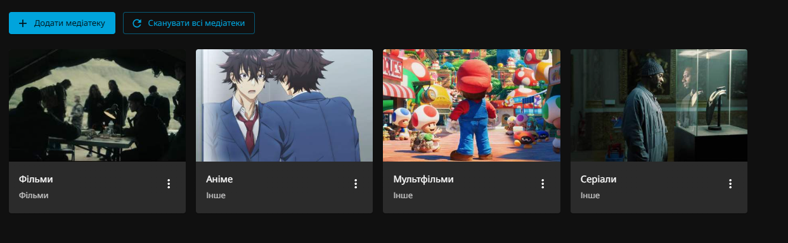
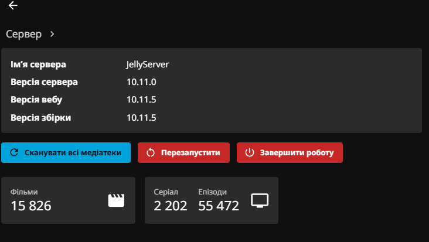
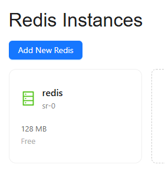
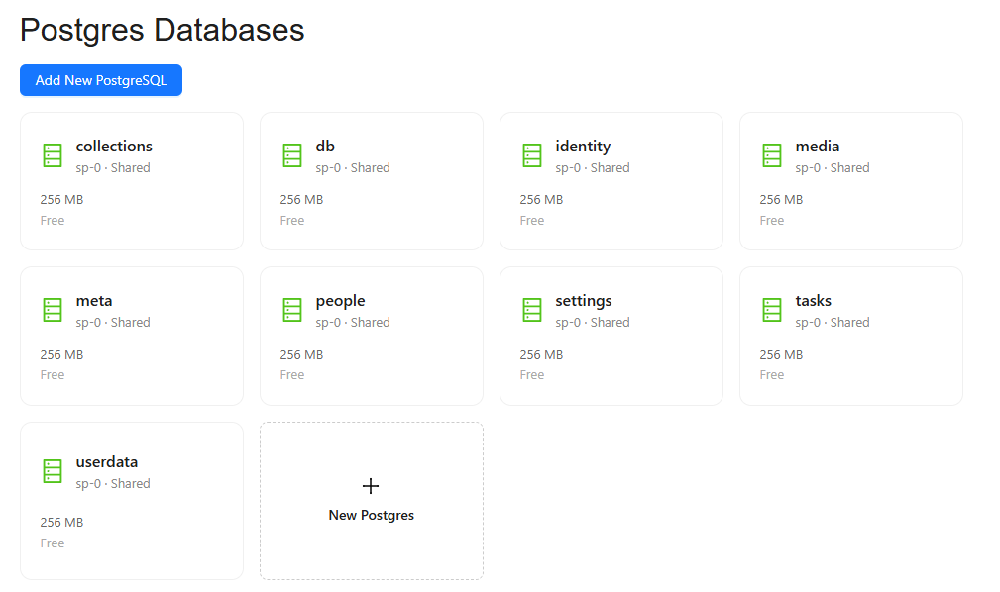
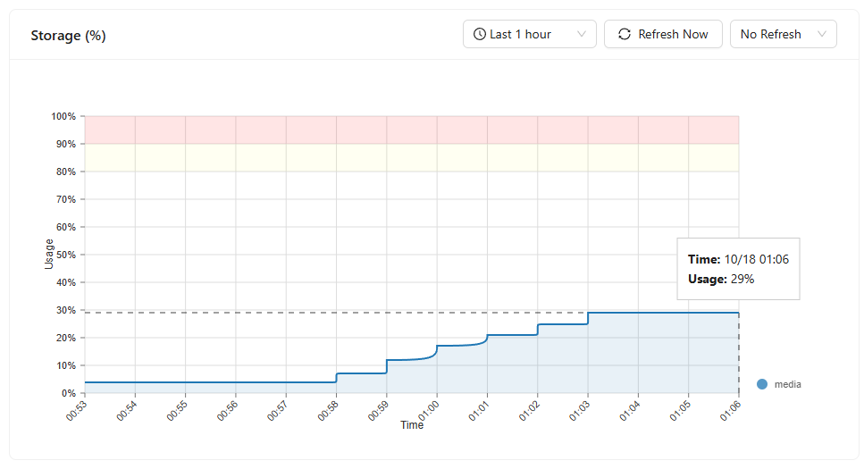
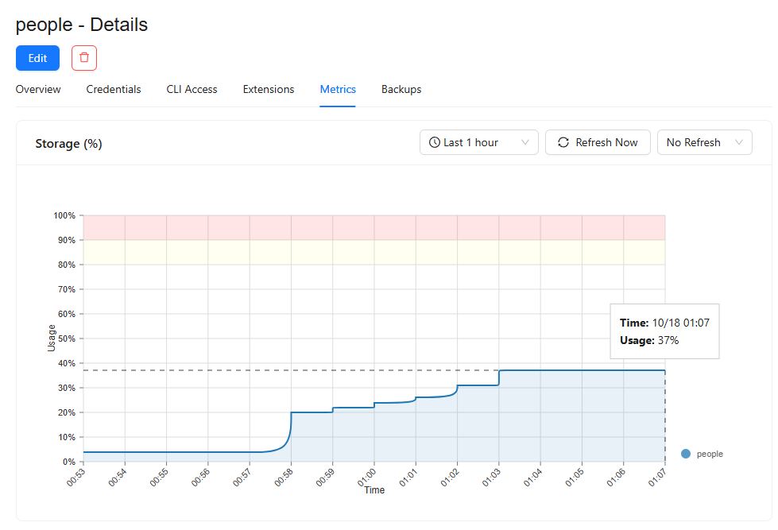
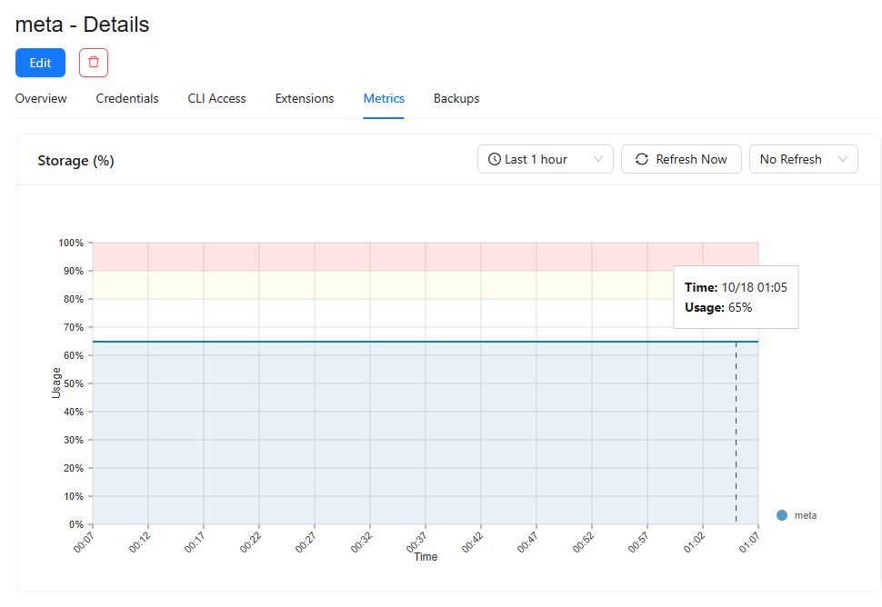
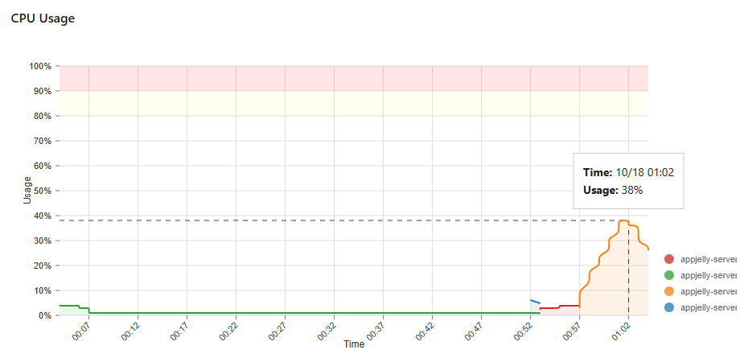
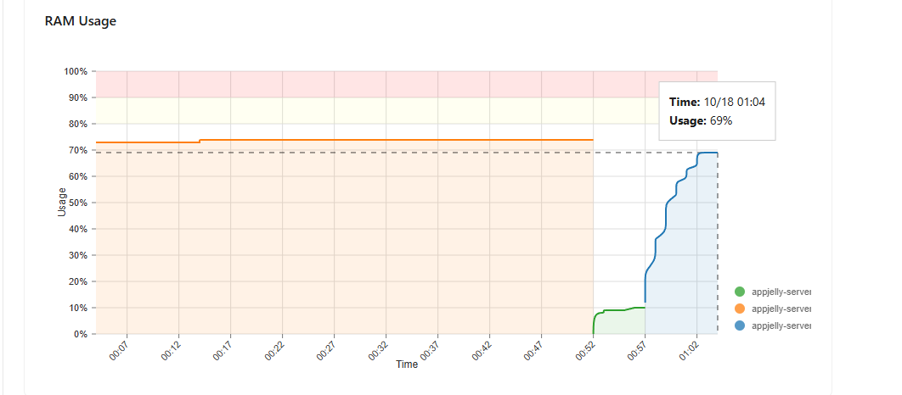

# 1 CPU / 1 GB RAM: JellyServer compared with Jellyfin

JellyServer is built for **high load and ultra-large libraries**: hundreds of thousands of items, many users at once, several app instances. The design follows from that:

- Every module has its own database, so the busiest data (catalog, media, people, user data) can each sit on a server of its own and grow apart.
- Redis caches items and query pages, and buffers playback progress, so the databases see bulk reads and batched writes rather than a query per request.
- Scans are incremental. Files whose fingerprint has not changed are skipped without being opened, and changed items are written in batches with binary `COPY`.
- App containers hold no state. Cluster-wide work such as scans and clean-ups is coordinated with Redis locks, so more instances can be added behind a load balancer.

The host on this page is the other end of that range: the smallest setup the same design runs on.

This page compares JellyServer with a regular Jellyfin server on a small host, using the same library and the same clients (jellyfin-web 10.11.5, Tizen). The JellyServer numbers below were measured in production. Jellyfin was not run on this host, so its side of the comparison is architectural. It comes from Jellyfin's 10.11 source code, not from measurements.

## How the two store and serve a library

| | Jellyfin 10.11 | JellyServer |
|---|---|---|
| Database | One SQLite file, `jellyfin.db` (EF Core, WAL journal), in the server's data folder. Items, people, media streams, user data, users and devices all live in it. | PostgreSQL, one database per module: catalog, media, people, collections, userdata, identity, settings, metadata, tasks. |
| Where the database can live | On a disk the server process owns: a persistent volume next to the app. | Anywhere reachable over the network. Here: nine free managed databases, 256 MB each. |
| Growth limit | The single file grows with everything; one disk has to hold all of it. | Each module has its own limit. When one fills up, part of it becomes a new module (as on this page). |
| People | A `Peoples` table plus a `PeopleBaseItemMap` row per credit. | `persons` once plus one credits row per item, with arrays and a GIN index. |
| Media files and streams | Rows in `BaseItems` plus `MediaStreamInfos`, in the same file. | Its own module and database (`media.sources`), read only by playback and item pages. |
| Caches | In-process. | Redis (128 MB here): items, query pages, the playback-progress buffer, cluster-wide locks. |
| App container | Holds state (database and metadata on its volume). | Stateless: the container can be rebuilt or replaced, and only the external databases keep state. |
| Upgrades that reshape data | Migrations rewrite `jellyfin.db` in place, which needs free disk for the rewrite. | One module's database at a time. Here the catalog was emptied and rebuilt by a rescan, because a rewrite would not fit in 256 MB. |
| Clients | jellyfin-web, Tizen and other Jellyfin apps. | The same apps, through the same Jellyfin API. |

What this means on this host: the plan here is free managed databases capped at 256 MB each, plus a stateless app container. Jellyfin would need its whole library database on a volume attached to the app, and that one file would have to fit all the data. JellyServer spreads the same data over databases that each stay under 60%.

The rest of the page is the JellyServer measurement.

## The migration

The production stack runs on hostim.dev. The app is one container with 1 vCPU and 1 GB RAM. Every module database is a free shared Postgres (`sp-0`, 256 MB each). This page records what happened on 2026-10-18, when commit `a665752` went live. That commit split the catalog into three modules: Catalog, Media and People. It also added the Collections module.

Library after the rescan: **15,826 movies, 2,202 series and 55,472 episodes** (seasons not counted), in four libraries. Many of the files are `.strm` files or alternate versions, and items carry TMDB metadata.

## Setup

| Part | Plan | Size |
|---|---|---|
| App `jelly-server` | `sa-1-1` | 1 vCPU, 1 GB RAM |
| PostgreSQL × 9 (one per module) | `sp-0`, shared, free | 256 MB each |
| Redis | `sr-0`, free | 128 MB |

The libraries are Фільми (Movies), Аніме (Anime), Мультфільми (Cartoons) and Серіали (Series). Anime, Cartoons and Series are `mixed` libraries: they hold movies and shows together.

The dashboard reports server version 10.11.0 and jellyfin-web 10.11.5. The counts above come from this page.

Redis holds the item and query caches and the playback-progress buffer.

## Result

| Database | Before | After | Change |
|---|---|---|---|
| `db` (Catalog) | 90% (~230 MB) | **57% (~146 MB)** | −84 MB, out of the red zone |
| `media` (new) | — | **29% (~74 MB)** | files and versions of items |
| `people` (new) | — | **37% (~95 MB)** | persons and credits |
| `collections` (new) | — | empty | playlists and box sets |
| `meta` (Metadata) | 65% (~166 MB) | 65% | unchanged; now the largest after Catalog |

Percentages come from hostim's storage metric, so MB values are approximate (256 MB × %). An empty database already shows about 4% (~10 MB).

No database is above 60% any more. Before the split, the catalog alone was at 90%, and a few thousand more items would have filled it.

## Databases

Nine databases, one per module:

## Catalog (`db`)

- **Until 00:57:** a flat 90%. That was the single `items` table with files, people and provider data in it.
- **00:57:** migration `007_split_media_people` emptied the table. Usage fell to 4% at once. `TRUNCATE` frees the files immediately, whereas dropping columns would have freed nothing without a table rewrite, and a rewrite needs space the database did not have.
- **00:57–01:06:** the startup scan wrote every item back in steps, library by library, and usage settled at **57%**.

The 57% is higher than the 121 MB measured on a fresh copy of the same data (~47%). The scan updates rows several times: once on insert, then for child counts and "last added" aggregates, and again when the stored TMDB answers are laid over. The difference is dead row versions, which autovacuum makes reusable inside the table. Expect the number to stay flat, not to keep growing, on later scans.

## Media

The database grew from 4% to **29%** between 00:58 and 01:03, in the same steps as the catalog. It holds one row per playable file (main files plus versions), with stream info and sidecar subtitles. A local copy of the library had ~140k such files.

## People

The database grew from 4% to **37%**. The jump at 00:58 is the first large batch of persons. Each person is written once, and after that only credits are added, one row per item. A local copy of the library had ~182k persons and ~70k items with credits.

## Metadata (`meta`)

Flat at **65%** for the whole hour; the split did not touch it. It holds the raw TMDB answers (`metadata.item_remote`) and the lookup state. It is now the database to watch: if it grows past ~80%, the raw answers (which include cast lists) are the first candidate for trimming or a module of their own.

## CPU

- **Idle (old build):** 1–4%.
- **Rollout at 00:52:** the build switched containers (the colour changes in the legend).
- **Rescan (00:57–01:03):** peak **38%** at 01:02, then back down as the scan finished. The 1 vCPU was never saturated.

## RAM

- **Old build (until 00:52):** a steady 73–74% of 1 GB.
- **New build:** about 10% while the app waited for the old container to stop. During the rescan it rose to **69%** by 01:04 and levelled off. That is just under the old build's steady state, measured right after a full rescan.

## Timeline (2026-10-18, server time)

| Time | Event |
|---|---|
| 00:52 | New build rolled out; the old container stops |
| 00:57 | Migrations: Catalog 007 (empty `items`, drop moved columns); Media, People and Collections 001 |
| 00:57–01:03 | Startup scan rebuilds all items into Catalog, Media and People; stored TMDB answers are laid over again |
| 01:03 | Media and People stop growing; the scan is done |
| 01:06 | Catalog settles at 57% |

The libraries looked empty for about six minutes, from the migration until each library's part of the scan was written. Watched state and favourites were kept, because item ids are derived from file paths.

## Takeaways

- Compared with Jellyfin: the same library and clients run on free 256 MB managed databases and a stateless 1 vCPU / 1 GB container. Jellyfin keeps everything in one SQLite file on the app's own disk. A measured Jellyfin run on the same host is still to be done.

- On 256 MB databases, split by module, not by table: each module now has room to roughly double.
- `TRUNCATE` and a rescan is the only migration that fits when a database is near its limit. Any in-place rewrite needs the same space again.
- 1 vCPU and 1 GB RAM are enough for a full rescan of ~73k movies and episodes: CPU peaked at 38% and RAM at 69%.
- Next to watch: `meta` (65%).
